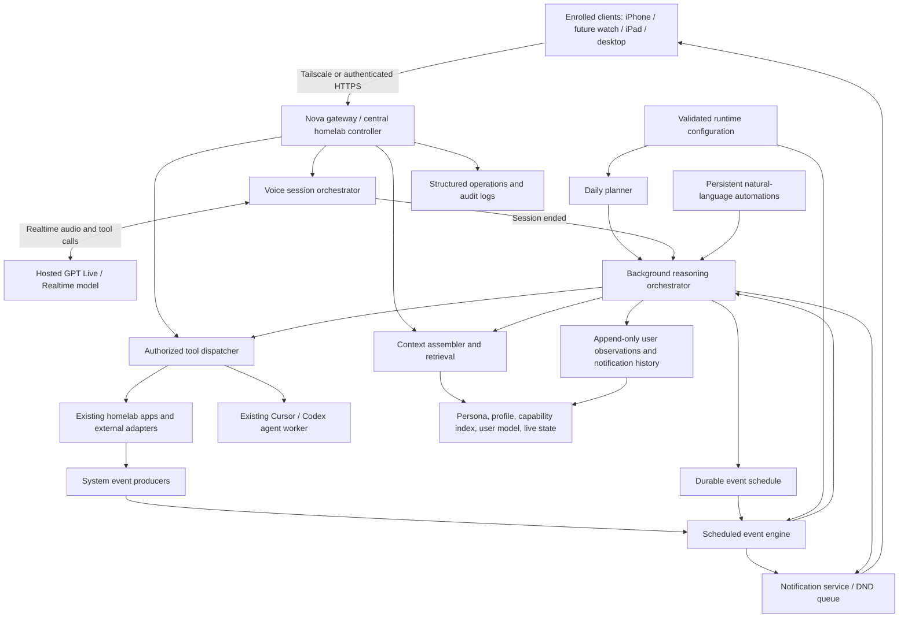

# NOVA — Master Architecture & Design Decisions

**Status:** V1 design baseline, consolidated from the design conversations through November 24, 2026.  
**Audience:** The coding agent implementing Nova in the existing homelab repository.  
**Scope:** Architecture, behavioral contracts, safety, context, scheduling, notifications, integration and implementation guidance. This is a design specification, not a claim that these components already exist.

## 1. How to use this document

Implement the agreed decisions below as the baseline. Inspect the existing repository, deployment configuration, app APIs, notification infrastructure and agent worker before changing anything. Reuse working components rather than creating parallel systems. Proposed schemas, paths, defaults and build phases in this document are implementation guidance, not immutable decisions. Do not assume illustrative endpoint names or containers exist. Identify conflicts with the existing system and ask before making consequential architectural changes. Follow the repository's agent instructions and update them with the runtime-protection and documentation rules in this document.

The user's original wearable concept has changed: Nova may primarily be used through an iPhone rather than a smartwatch. The architecture must not depend on a particular client. Client UI design, hardware choice, and final app packaging are out of scope for this baseline.

## 2. Product vision

Nova is a persistent, evolving, voice-first personal agent hosted by the homelab. She is not merely a chatbot or a collection of independent app shortcuts. She should know what the user is working on, understand explicitly stated goals, help plan time, follow up on commitments, learn from outcomes and proactively suggest conversations or reminders. She should respect the user's autonomy: commitments and goals originate from the user; Nova helps the user follow through rather than imposing goals of her own.

Primary experiences:

- Start a voice conversation from an enrolled device with minimal friction and speak immediately.
- Ask questions about the user's apps, goals, calendar, projects, homework, finances or homelab; perform permitted actions conversationally.
- Ask what to do with newly available time and receive suggestions informed by goals, schedule and current circumstances.
- Receive simple factual reminders and separate invitations to discuss a plan or decision.
- Create, change or remove one-off or recurring reminders and behavioral settings through voice.
- Delegate software and infrastructure questions or changes to the existing coding agent worker, without Nova itself acting as a coding agent.
- Grow a durable, portable understanding of the user across sessions and future model migrations.

**Core philosophy:** AI interprets language, context and ambiguity; ordinary code handles deterministic execution, security, state, schedules and delivery. The homelab is the authority. Clients are interfaces. Models are replaceable reasoning engines, not databases or trusted execution authorities.

## 3. High-level architecture



Diagram is logical, not a mandated container topology. Existing services may implement multiple logical responsibilities. Avoid cyclic runtime dependencies that prevent Nova or the coding agent from recovering a failed service.

### 3.1 Responsibilities

| Component | Responsibility |
|---|---|
| Client | Microphone, speaker, controls, device authentication, location reporting, notification UI, confirmation UI |
| Gateway/controller | Auth, authorization, tool execution, confirmations, app routing, auditability |
| Voice orchestrator | Realtime session lifecycle, context injection, tool-result delivery |
| Background reasoner | Daily planning, scheduled/system-event reasoning, memory updates, consolidation |
| Event engine | Persistent event scheduling, condition/trigger handling, execution lifecycle and retry bookkeeping |
| Notification service | Device delivery, app/deep-link routing, DND gating and queue release |
| Apps/adapters | Authoritative domain data and actions, goals and relevant progress |
| Coding worker | Code/repo inspection, development, diagnostics and controlled infrastructure changes |

## 4. Model and voice architecture

### 4.1 Hosted voice model — agreed

Use hosted GPT Live (the appropriate supported realtime API model at implementation time) for conversational voice rather than buying hardware to run a local LLM now. Do not require a GPU upgrade for V1. The precise API model identifier, transport, pricing and SDK must be verified against current documentation when implementing. ChatGPT consumer subscription access is not assumed to cover API charges.

The user's working cost tolerance was approximately $25/month for Nova voice use; this is a preference, not a verified pricing estimate or a hard cap. Usage may be around 15–20 minutes of voice per day, potentially less; background reasoning adds separate usage. Instrument token/audio usage, session duration and estimated costs. Do not leave a billable realtime voice session open all day. Preserve model/provider independence at the service boundary so later local or alternative models can use the same memory, tools and event system.

### 4.2 Voice startup and lifecycle

- Aim for press-and-speak behavior, without waiting for a greeting or completed network handshake.
- Capture/buffer microphone audio after the user's explicit voice activation while the session connects, then transmit in order once ready. Prewarming the connection on opening the app may be explored if useful; do not activate the microphone silently.
- A previously discussed wearable flow was watch face → button → homelab app → dial initiates voice. This is not a required hardware/UI design. Phone or other clients may implement equivalent controls.
- Inject the compact bootstrap context at session start and retrieve further context on demand. Avoid repeatedly injecting the full history.
- Tool calls must pass through the authenticated gateway, not directly from model to arbitrary services.
- End voice sessions promptly when the user closes them. Post-session work happens separately on the homelab, not inside the live audio session. The user must not wait for memory processing to finish.
- Preserve sufficient conversation/tool context for the background pass and future continuity, subject to secure retention. Surface errors rather than pretending an action succeeded.

### 4.3 Background reasoning

Use a separate non-realtime reasoning invocation for daily planning, event reasoning, post-session memory updates and consolidation. Exact model/provider and prompt boundaries remain implementation choices; reuse a model abstraction and shared context assembly. Avoid continuous LLM calls. Deterministic event processing handles normal execution and invokes reasoning only when needed by the agreed event policy.

## 5. Context and memory

### 5.1 Five logical context layers — agreed

| Layer | Contents | Loading policy | Authority |
|---|---|---|---|
| `persona.md` | How Nova speaks and acts: tone, concision, initiative, coaching style | Always loaded, compact | Explicit user-directed runtime updates |
| `profile.md` | Stable user-provided facts/preferences/routines | Compact bootstrap | Explicit user-directed runtime updates |
| Capability index | Concise descriptions of available apps/actions; references to exact schemas | Compact bootstrap; detailed schemas on demand | Coding agents / trusted deployment process only |
| Live state | Current time, DND, location, calendar, service/app status, deadlines as needed | Small useful snapshot and on-demand queries | Authoritative sources, not editable as memory |
| `user-model.md` (formerly behavior.md) | Evolving knowledge of the user, observations, interests, projects, classes, routines, behavioral patterns, reminder effectiveness | Retrieve relevant portions on demand; summarize when useful | Nova may update during any reasoning pass |

The source files are separate, even though the gateway assembles one unified bootstrap. Keep the persona very short (a few hundred words as a target, not a fixed user-specified limit); consolidate/rewrite instead of appending contradictory instructions. Maintain a compact profile and capability index. Include minimal live context where useful, rather than loading all app state. Exact bootstrap token budgets and relevance strategy remain implementation details.

The model must know at a high level what it can do: e.g., manage homework, categorize transactions, control lights, consult the agent worker. It should not need every endpoint's schema in every prompt. Retrieve exact callable tool definitions when required. Runtime permission checks apply irrespective of what the model sees.

### 5.2 Additional stores (not permanent bootstrap text)

- `automations.md`: persistent natural-language automation instructions, editable by explicit user request.
- `nova-config.yaml` (format provisional): validated system behavior settings, editable via approved runtime operations when explicitly requested.
- Durable daily/one-off event records: structured executable events, not a Markdown prompt.
- Append-only raw observations/history, conversation-derived notes, notification and outcome records: durable evidence for the evolving user model.
- Operations/audit logs: execution history, separate from personal memory.

### 5.3 Retrieval and consolidation

The homelab can retain very large files and records without sending all of them to the model. Retrieve relevant passages or records by topic, time, entity or semantic relevance (implementation choice). Include dates and evidence references when feasible. For example, fetch gym history for a gym planning question, and drone project history for a project-related conversation. No requirement that one file equals one context window.

Every reasoning invocation (daily planning, event reasoning, system-event reasoning, post-voice processing) can read the user model and append/update relevant learnings. Do not require repeated evidence before recording an individual observation. Repeated evidence is needed before confidently asserting a pattern. Distinguish user statements, actual observed outcomes and tentative inference. Examples:

- Observation: user said they are working on a drone project in class.
- Observation: planned gym visit did not occur, if verified by an authoritative source or user report.
- Pattern: multiple gym reminders after class have not led to gym visits; consider different scheduling.
- Tentative inference: user appears interested in VR; do not state as confirmed fact unless supported.

The user model should cover broad personal context, not just habit tracking: interests, academic work, projects, current activities, people/context when relevant, preferences and changes over time. It should help conversations feel continuous and personally informed.

Nova may consolidate, reorganize and prune the *working summary*. Before overwriting/consolidating, preserve source observations and relevant prior summary/version information in durable append-only history. Never silently discard underlying evidence simply because the compact working model changed. Keep history exportable in a provider-independent format for future local models or reprocessing. Distinguish stale information from current information and retain provenance. User-directed deletion/privacy requests need an explicit procedure; the append-only policy is for ordinary consolidation, not a prohibition on legitimate user-authorized removal.

### 5.4 Bootstrap from exported ChatGPT data

User intends to export ChatGPT history and seed Nova's initial user model using a one-time consolidation pass. Build an optional import workflow: ingest supplied export, extract relevant stable facts, projects, interests and observations, distinguish explicit facts from inferred patterns, deduplicate and preserve source references/dates. User reviews the initial condensed memory. Store imported personal data securely; do not expose the complete export in every prompt. The export is not currently supplied as part of this specification.

### 5.5 Write ownership

| Store | Runtime Nova may do | Coding agent / system |
|---|---|---|
| Persona | Edit on explicit user direction | May edit when appropriate to a coding task; runtime-impact protection applies |
| Profile | Edit/correct on explicit user direction | Same |
| User model | Read/update/consolidate autonomously when relevant | Maintain schema/migration tooling |
| Raw user history | Append observations; read/retrieve | Append/manage retention; no silent loss in consolidation |
| Automations | Add/edit/remove on explicit user direction; manage one-off lifecycle | Maintain implementation |
| Runtime config | Change allowlisted settings on explicit request | Maintain validated schema and deployment settings |
| Capability index | Read/use; cannot directly edit/register arbitrary endpoints | Cursor/Codex or trusted deployment process maintains it |
| Live state | Read; request permitted domain actions via gateway, not fabricate observations | Source apps/system produce updates |
| Event schedule | Add/change/cancel events during conversations and reasoning | Scheduler enforces lifecycle |
| Audit logs | Cannot rewrite or delete own evidence | Trusted append/retention mechanism |

**Post-session automatic write-back:** only the user model and its evidence history are autonomously updated by the memory pass. Explicitly requested persona/profile/config/automation changes can be applied during the conversation using authorized tools, with a spoken acknowledgment after success. Do not use post-session inference to silently change them. Other reasoning passes may independently schedule events and send notifications as part of their operational tasks; that is distinct from changing standing configuration or long-term automation rules.

## 6. App integration and federated goals

The central gateway is the switchboard. Existing apps remain their own data authorities. Do not copy all app data into Nova or create a monolithic goals app.

Each relevant app should expose a common goals interface (read and, when appropriate, write), adapted to its own domain. Nova can query across them and reason about competing commitments. Examples: gym weekly attendance/fitness progress, guitar practice objectives, learning topics and desired timeframes. A common goal representation might include stable ID, source app, description, target, period, priority, progress, status and links to details. Exact schema, API conventions and which apps implement goals remain open.

Use a registry/facade with adapters for existing APIs rather than forcing every service to be rewritten. Capability index entries should describe supported actions, schemas, required device scopes and risk/confirmation policy; exact schemas and enforcement are maintained by code, not model-generated guesses. App capabilities may include goals, state reads, domain actions and emitted events as relevant; not every app needs all categories.

Examples of app integration:

- Homework: existing app already manages manually entered assignments, deadlines, recurrence and completion. It is the source of truth. Nova can add/remove/update assignments when permitted and query completion before reminders. No separate homework data model is required.
- Calendar: connect to a suitable calendar API for reading schedule and creating agreed events. Provider and exact integration are open. Nova should be able to discuss availability, choose a time with the user and schedule it.
- Gym: planned app should expose goals and workout/visit progress; absence of data must not be interpreted as proof of absence. Calendar, location and user reports may provide contextual evidence, with confidence distinguished.
- Guitar and learning: domain-specific goals, progress and interests.
- Theology: spiritual reminders, learning and related content/actions.
- Finance: read-only bank/Plaid integration regarding actual funds; app-local budget and transaction categorization operations only (see permissions).
- Home controls/media/kiosk: reuse current homelab capabilities and APIs.

When new endpoints are added, changed or removed by coding agents, update the capability index and relevant documentation in the same change; validate the registry against implementation. Nova should recognize new capabilities in the next bootstrap without manual editing of her persona or needing to invent an endpoint.

## 7. Security and permission model

### 7.1 Trusted devices and network paths

- Tailscale preferred when available; secure authenticated HTTPS public fallback to accommodate networks that block VPNs (e.g., airplane Wi-Fi). Actual reachability on captive/restricted networks is not guaranteed.
- No unauthenticated public app/gateway access. Every accepted device/request path must identify an enrolled device and enforce appropriate authorization. Tailscale membership alone must not replace per-device scope checks.
- Distinct revocable device credentials; no single shared universal key. A device may authenticate using a securely stored credential exchanged for short-lived tokens or an equivalent validated mechanism. Store secrets securely; never place them in model context or logs.
- Device-specific least privilege: e.g., iPad may access theology only, primary phone/watch may access many apps. Compromise of a narrow-scope credential must not confer broader access.
- No mandatory second-device approval just to connect through the public fallback. User considered and rejected that complexity for V1.
- Scope user-initiated sessions and their downstream tool calls to the originating authorized device. Background services use separate appropriately scoped service identities; do not use background identity to bypass a restricted client.

### 7.2 Action policy

Default philosophy: most reads and routine state changes are automatic. Do not add unnecessary double confirmations. All actions are logged, independent of whether approval is needed.

| Policy | Examples |
|---|---|
| Automatic | Authorized reads; lights/media; normal notes and app updates; homework operations within ordinary allowed scope; transaction categorization; finance projections; ordinary reminders/automations/config adjustments explicitly requested |
| Explicit confirmation | Creating a finance categorization rule; adding/adjusting budget sections or significant budget structural changes; sending a coding-agent change prompt; commands the coding worker flags for approval; Nova-critical runtime-impacting deployments; other specifically identified destructive or security-sensitive operations |
| Forbidden | Spending, transferring or moving real money; no such callable capability exists, even with confirmation; unauthorized device actions; attempts to bypass gateway permission checks |

Future app-specific rules should be documented and enforced by gateway policy. Approval is scoped to the specific proposed action and parameters, expires or is consumed appropriately, and is recorded. The model cannot grant itself approval. Read-only code questions can be delegated normally under the authorized worker contract; code-change requests are shown/read back for user confirmation before dispatch. Cursor/Codex otherwise operates in the desired auto-approve mode for allowed operations, while surfacing any command/tool approval it actually requires. Do not interpret auto-approve as permission to bypass protected runtime actions.

For routine explicit requests, a success acknowledgment (e.g., “I moved the daily planner to 6 AM”) is enough; do not ask again before executing unless the policy requires approval. Only acknowledge success after the action actually succeeds.

## 8. Coding-agent delegation and runtime protection

### 8.1 Worker contract — agreed

Reuse the existing homelab agent worker. Nova is a conversational orchestrator, not the repository coding agent. For questions about the code or infrastructure, delegate to Cursor/Codex and summarize the returned result. For requested changes, show/read back the prompt and obtain the required approval, then send the task to the worker. Nova itself should not inspect/edit source code or run arbitrary shell commands as a substitute for that worker.

Use synchronous request/response as the public interaction model, not a new job-queue architecture. The worker returns success, failure, result/summary or a scoped approval request. Support resuming an approval-gated operation through the existing worker mechanism or a minimal continuation identifier. Use bounded timeouts and clear failure reporting; do not falsely report completion or retry a potentially mutating operation blindly if its result is unknown. Implementation must account for long-running requests without unnecessarily holding open a billable voice stream; if the current worker cannot support the chosen UX, surface the issue rather than silently creating a new architecture.

### 8.2 Protect the running voice path — agreed refinement

The protection is **runtime impact**, not blanket protection of every Nova-related file. Coding agents may inspect and edit files appropriate to a task. Before actions that could interrupt/destabilize Nova's running voice/control path, however, they must explicitly ask the user. This includes stopping, restarting, rebuilding, recreating, redeploying, or disrupting dependent networking/auth services, and applying changes with equivalent live effects (including auto-reloads).

Maintain an explicit dependency inventory in `AGENTS.md` or a referenced policy/manifest: which actual files/components/services affect the voice path and which operations can interrupt it. Determine this from the repository and deployment graph; do not assume names. Possible dependencies include gateway, voice service, shared proxy/network, auth, worker bridge and any shared kiosk/container component actually serving Nova.

- Direct Cursor/Codex use: request approval before disruptive operation.
- Through Nova: worker returns a confirmation request before disruption; Nova conveys it; approval authorizes only that operation.
- Normal unrelated containers: routine permitted restarts may be automatic. If kiosk restart can interrupt Nova, treat it as critical rather than assuming isolation.
- Editing source without a live effect is not itself the forbidden action. If file edits immediately affect a running process, they fall under runtime-impact approval.
- Changes to the coding agent/worker itself should use an external agent or manual path when self-modification would remove the controlling/recovery channel.

Before critical changes, state anticipated impact, recovery path and verification steps. Preserve rollback/recovery capability. Enforce through runtime/deployment controls where possible; `AGENTS.md` alone is guidance, not a hard technical security boundary. Log proposal, approval and execution results.

### 8.3 Self-healing ambition

Create a repository Markdown policy describing what the operations/coding agent can do, including checking containers, health diagnostics, restarting/starting services, safe changes, dependency isolation and recovery. Nova should eventually be able to notice failures and request safe repairs through the worker. Do not allow unbounded retries or arbitrary autonomous self-modification. Define automatic versus approval-required remediation and rollback before implementing autonomous repairs. User explicitly wants this capability but has not finalized its detailed policy; build safe monitoring/integration foundations in V1 rather than inventing unrestricted self-healing permissions.

## 9. Event engine and daily planning

### 9.1 Two-layer automation model — agreed

`automations.md` is natural-language instructions intended for an AI to interpret, not a rigid machine-only recurrence language. It can express context-dependent conditions that ordinary static cron cannot resolve, such as “on days I plan to go to the gym, remind me to bring a water bottle 15 minutes before my first class.” It should support recurring and future one-off instructions. Nova can modify it on user request.

At the configured daily planning time (initial example 8 AM; user can change to 6 AM or any suitable time), a background reasoner reads applicable automations, calendar, live state, goals and relevant user memory/context. It creates concrete scheduled events for the day using validated event APIs. Ordinary code then runs those events. The planner may also schedule proactive reasoning check-ins based on predicted needs, commitments and calendar windows. It need not send a notification for every check-in.

The temporary/daily schedule is structured persistent data, not another prompt Markdown file. Events may span dates; a future one-off reminder must not be lost at midnight. Nova can create, cancel and modify events at any time during a voice session or background reasoning pass. A changed plan should trigger a targeted schedule update rather than waiting for the next morning. One-off instructions are retired from the active automation file once durably scheduled/consumed as appropriate, with archival/provenance and failure recovery; recurring instructions remain. Do not delete the sole copy of an instruction before its generated event is durably stored. Daily planning should reconcile its own generated events without wiping manually added events or duplicating already fired events.

### 9.2 Trigger mechanisms — hybrid

Scheduled events use deterministic time checking/polling of due events. Polling frequency is configurable; no model invocation per poll. The engine can recover due events after restart subject to relevance/expiry rules.

System events are push/subscription-based into the same event engine. Producers may include service health monitors, app/calendar updates and debounced location transitions. An external producer may internally poll a source that has no push API; this does not require Nova itself to reason on every poll. Examples: a service goes down, user arrives at gym, calendar changes. Normalize events, deduplicate noisy updates and invoke a reasoning pass when meaningful. A known intentional service restart or irrelevant outage can result in no user notification. Monitor events must avoid notification/reasoning storms.

### 9.3 Event structure

Agreed conceptual fields: trigger (time or condition), plain-language instruction, reasoning flag, notification behavior, follow-up capability and status. Suggested concrete schema (adapt to repo conventions):

```yaml
id: unique-event-id
source: daily_planner | voice | reasoning | system | automation
source_ref: optional-reference
trigger:
  type: scheduled | system_event | condition
  at: optional-timezone-aware-timestamp
  condition: optional-validated-condition-or-instruction
reasoning_required: true
instruction: Check whether the user still has time to pick up coffee after the gym.
notification:
  mode: none | reminder | conversation
  priority: low | high
  app_target: optional-app-id
  deep_link: optional-validated-target
  relevance: optional-rule
allow_follow_up: true
status: scheduled | running | completed | cancelled | failed | expired
```

Actual event records contain concrete values, not the pipe-delimited options shown above. Additional suggested fields: created/updated time, execution attempt, idempotency key, provenance, correlation ID, retry policy, expiry, reasoning result and outcome. Store state changes atomically so duplicate scheduler ticks or restarts do not duplicate notifications/actions.

Reasoning and notification are independent dimensions. An event may be notification-only, reasoning-only, both, or neither (e.g., an internal deterministic state task if needed). Reasoning can decide to remain silent, send a reminder, invite a conversation or create follow-ups. Notification behavior can be set explicitly or resolved by reasoning. A conversational notification is an invitation to talk, not an automatic live audio session.

For checks such as “is homework complete?”, the user described these as reasoning-plus-notification events. Preserve that conditional semantic behavior, but where no judgment is needed, an ordinary validated API check can implement it without paying for an LLM. Context-dependent decisions should invoke actual reasoning.

### 9.4 Adaptive planning

Nova can ask the user about schedule changes and adjust reminders conversationally. Prefer around 9 AM for nonurgent planning conversations, but may ask at other useful times when DND is off. A weekly short recalibration was agreed in principle; exact scheduling is configurable. Do not assume semester-specific class/Mass schedules are permanent. Use calendar and user-provided context. Reason from observed patterns (e.g., usual weekend gym attendance) without treating patterns as certainties. Conversation makes/revises a plan; neutral reminders support execution; observed outcomes inform subsequent reasoning.

### 9.5 Geofenced location system events

Phone reports location or provides platform geofence events. Define user-configurable named places (home, class building, gym, cathedral, campus, etc.). Use accuracy-aware geofences with separate enter/exit thresholds where feasible, dwell/debounce and duplicate suppression. Initial discussed dwell was roughly 90–120 seconds, not a mandated value. The locations discussed are generally 10–20 minutes' walk apart, making broad place recognition plausible, but precise building-level detection is not guaranteed indoors or near adjacent buildings. Test on the actual device and locations. Low-confidence fixes should not imply arrival/exit. Do not treat GPS jitter as repeated reasoning events. Observe OS permission/background limitations and treat location as unknown when stale. No raw continuous GPS-to-LLM stream.

## 10. Notifications

### 10.1 Notification behavior and routing

Reuse the existing homelab notification infrastructure after inspecting it. Do not build a redundant push stack simply because the current implementation was not provided in this conversation. The notification service is independent of the AI reasoning engine and client UI.

| Mode | Behavior on receipt | Behavior on tap |
|---|---|---|
| Reminder | Brief, neutral factual text; no reply expected | Open relevant app; optionally deep link to the relevant record; otherwise open homelab homepage |
| Conversation | Invite the user to discuss something with Nova | Immediately launch the Nova voice conversation with the relevant event context |
| Actionable (reserved) | Optional future simple buttons/actions | Perform explicitly defined permitted action |

Reminder text is not a place for personality or escalating tone. A repeated homework reminder can use the same wording each time. Nova's personality matters during conversations and when she is actually asking the user a question. The user wants passive reminders and voice prompts primarily; retain extensibility for simple actionable notifications without building unnecessary UI now. Confirmation requests for protected actions remain a distinct security workflow, not ordinary passive reminders.

Voice prompts should carry a reference to the triggering event and why Nova wanted to talk, so the next session does not start unaware of the conversation topic. Launching voice is the result of the user's tap; respect platform microphone permission and foreground requirements. Do not start listening from an unattended push.

Every notification can have an optional app target and optional deep link. Homework notifications open the homework app (and assignment if supported). Unrelated reminders such as “Bring your water bottle” open the homepage. The homepage may become a native app; do not hardcode routing to a PWA or watch. Validate all targets against the trusted app registry. Device delivery preferences and platform-specific presentation are configurable; exact multi-device routing and duplicate handling remain implementation details.

### 10.2 Two priorities, no critical override

- `low`: ordinary notification, normal delivery behavior.
- `high`: more noticeable presentation where the platform permits it (custom vibration or other stronger alert was proposed, not guaranteed by iOS notification APIs).
- There is no `critical` tier and **no notification is allowed to bypass homelab DND**. This includes high-priority and infrastructure notifications. Do not enable critical alert or time-sensitive bypass mechanisms that conflict with that policy.

### 10.3 Global DND

The user especially wants uninterrupted Mass and adoration. In class, ordinary notifications are acceptable unless DND is explicitly on. The intended synchronization is a phone automation/Shortcut that informs the homelab when phone DND is enabled or disabled. Verify feasibility on the user's actual iOS version and notification transport. Also support manual toggle/state inspection on the homelab. Treat DND as a central delivery gate across all enrolled devices, not a per-model preference that Nova can override. A DND transition should be an authenticated system event.

While DND is on, scheduled checks, background reasoning and other normal non-notification work may continue. All intended notifications enter a durable queue instead of being delivered. When DND turns off, evaluate their current relevance before release. Do not cancel the underlying task simply because delivery was deferred. Handle stale/unknown DND synchronization deliberately; proposed conservative default is not to send queued notifications until the state is known. This fallback is an implementation recommendation, not a separately confirmed user decision.

### 10.4 Relevance, expiry and queue release

Each notification has a relevance policy. Three agreed types:

- Persistent/condition-dependent: send after DND if the condition still applies (e.g., incomplete homework). Use a deterministic API check where possible.
- Time-limited: discard when no longer actionable (e.g., leave in ten minutes, after the relevant departure window).
- Recheck with reasoning: reevaluate ambiguous context-dependent relevance (e.g., is there still time to pick up coffee after the gym?).

Collapse duplicate queued reminders where appropriate rather than sending four homework reminders at once after DND ends. Keep record of suppressed, expired, canceled and released notifications even if they are not delivered. Ensure release and normal delivery both go through the same DND gate and idempotency checks.

### 10.5 Notification history and learning

Retain first-class structured records of notifications rather than dumping every notification into user-model Markdown. Proposed fields: notification ID, originating event, created/scheduled/sent times, destination device, mode, priority, text, app/deep link, relevance/expiry, queued/suppressed/delivery status, opened/action events if observable, related goal/task, subsequent outcome and provenance.

Distinguish sent from device-delivered, opened, dismissed and acted upon. The operating system may not report every dismissal, open or action. Mark unavailable telemetry as unknown rather than assuming that a notification was ignored. Likewise, a workout after a reminder is an observed association, not proof the reminder caused the workout.

Nova can use history to learn which reminders are useful, which are routinely missed, which times work and whether different planning approaches might help. Summarize useful patterns in the user model, retaining underlying history. If notifications appear ineffective, ask the user about changing strategy. Nova may propose stronger reminders or different frequency/timing; do not silently rewrite explicit standing rules or escalate intensity contrary to user preference. Personality/tone still applies to conversations, not factual reminder wording.

## 11. Initial automation behavior and scenarios

These are desired behavior examples from the design discussions, not hardcoded system features or a claim that a real reminder has been scheduled. Seed or configure them through the automation system and existing app interfaces when appropriate. The user may adjust them conversationally.

### 11.1 Homework deadline protection

For homework due that night at 11:59 PM, initial default check/reminder times are **6:15 PM, 8 PM, 10 PM and 11 PM**, in the user's local timezone. These were chosen around Mass and social commitments during the current semester; the user explicitly wants the general rule rather than elaborate day-of-week exceptions that will soon become obsolete.

At each time query the homework app. If complete, cancel remaining reminder events. If incomplete, send a neutral factual reminder linked to the homework app and arrange the next appropriate check. Clearing the notification does not mark homework complete. If DND is on, queue it and recheck relevance before delivery. No voice conversation or escalating language is required. If the app is unavailable, do not assume completion or noncompletion; handle retry/unknown state honestly.

### 11.2 Goal planning and gym progress

Around 9 AM, Nova may consider the user's goals, calendar and relevant observed patterns. Example: goal is three gym visits per week; by Thursday morning only Monday's visit is recorded, and the user usually goes once on weekends. Nova can identify that the user may miss the goal, invite a conversation, and help decide when to go. Weekly gym targets are examples, not a fixed user goal.

If the user says they will go after class, Nova may create a calendar event when appropriate and schedule a simple reminder around that time. Later reasoning can check whether the visit actually happened; if not, decide whether a future planning conversation is useful. Respect the user's choice not to go. Avoid treating a skipped workout as a failure requiring indefinite notifications.

### 11.3 Conditional packing reminder

User says: “On days I'm going to the gym, remind me to bring my water bottle 15 minutes before my first class.” Nova adds a recurring natural-language automation. The morning planner uses calendar, relevant recent conversation/user-model context and known plans to identify gym days, resolves first-class time and creates a concrete reminder. If the user changes plans mid-day, adjust applicable events where still useful. No calendar event for the gym is required if Nova has other reliable context that the user intends to go. If no first class exists or the plan is unknown, choose a sensible alternative only if supported by the instruction/context, or ask; do not invent a class time.

### 11.4 After final class / time planning

The end of the last class of the day is often the first meaningful block of free time. Nova can schedule a reasoning check near that time and consider available time, food, goals, homework, calendar and other commitments. Send an invite to talk if a useful decision is needed. The user may also simply ask “I have free time, what should I do?” at any point.

### 11.5 Spiritual reminders

User wants small, randomly timed spiritual reminders from the theology system, initially approximately once per hour during appropriate waking periods, adjustable to once every two hours or other frequency. Examples: remember to pray, call upon the guardian angel. They are passive reminders, not conversations. Never interrupt Mass/adoration while DND is active. Exact jitter, active hours and expiry remain configurable. A daily Mass-readings reminder around 4:30–4:45 PM was considered but not finalized; do not enable it as an agreed active rule without user direction.

### 11.6 One-off check-in created during voice

User says they have class, intend to go to the gym, then want to drive to Dutch Bros to get coffee for their girlfriend. Nova may infer a useful check-in near expected gym completion and create a one-off reasoning event to determine whether time remains. That event can result in silence, a reminder or a conversation invitation. No need to create a recurring automation for this. Do not hardcode the user's example 20-minute drive as a permanent travel duration.

### 11.7 Service failure system event

Health monitor emits a service-down event. The event engine deduplicates and invokes reasoning according to policy. Nova considers service criticality, intentional maintenance/restarts and actual impact. An irrelevant or intentionally restarting service may require no notification. A meaningful failure may warrant a notification or consultation. Automated repairs are subject to the self-healing and runtime-protection policies; DND still applies to notifications.

### 11.8 Config update via conversation

User: “Run the daily planning pass at 6 AM instead of 8 AM.” Nova invokes the validated config update tool, reschedules future planner runs, and acknowledges successful change aloud. No second confirmation for an ordinary setting. The config change is audited. Do not modify code just to change the planning time.

## 12. Configuration and persistence

Keep system configuration separate from persona, profile, automations, event records and history. Exact format is open (YAML or JSON are reasonable). Suggested initial configurable fields:

- Timezone, daily planner time, preferred planning/conversation window (initially around 9 AM), optional weekly review timing.
- Event polling interval and bounded retry/timeout behavior.
- DND synchronization and queue-release policy.
- Named locations/geofence thresholds/dwell; device notification routing preferences.
- Allowed operational settings exposed to Nova through validation; model selection/usage controls maintained through trusted configuration.

Do not put every reminder rule in config. Homework times, spiritual reminders and context-dependent packing instructions belong in the persistent automation layer or their source app. Do not give Nova arbitrary access to security configuration, credentials, endpoint registration or model/system guardrails through a generic config editor. The user wants ordinary behavior settings conversationally adjustable, not unrestricted mutation of the infrastructure.

Suggested storage layout, subject to existing repo conventions:

```text
nova/
  context/
    persona.md
    profile.md
    user-model.md
    capabilities.*        # maintained by coding agents / deployment
  automations.md
  nova-config.yaml
  data/                   # durable events, DND queue, notification history
  history/                # append-only personal observations, source references
  logs/                   # structured operations and audit records
AGENTS.md                 # endpoint maintenance and protected runtime rules
CHANGELOG.md              # meaningful code/infrastructure changes
```

A lightweight relational database (e.g., SQLite) is a reasonable starting point for durable structured event/notification state if the repository does not already have a suitable datastore. JSONL or an append-only database table are reasonable for history. These are recommendations, not fixed technology choices. Use atomic writes, schema validation and concurrency handling for editable files and scheduler data. Ensure concurrent voice, scheduled reasoning and post-session jobs cannot silently overwrite each other's changes. Use persistent volumes/backups and preserve portability of user memory. Backup/restore should cover memory, automation/config, event state, device enrollment data and logs as appropriate; credentials need secure backup/rotation, not plaintext dumps.

## 13. Logging, auditability and change tracking

The user explicitly wants everything going through the central homelab gateway logged, including attempts, settings used, confirmations and denials, outcomes and failures, to support diagnostics and future self-healing. Logging is universal, not a separate permission tier.

### 13.1 Gateway / operations log

Structured log for every gateway action and relevant event lifecycle. Recommended fields: timestamp/timezone, correlation/request ID, initiating device or service identity, session/event ID, endpoint/method/action, sanitized arguments and effective settings/version, permission decision, approval requested/granted/denied, execution start/end/duration, success/error/timeout, safe result summary and retry status. Also record auth failures, worker calls, notifications, service health events and deployment operations where appropriate. Correlate logs across services. Include enough diagnostic information for the homelab/coding agent to investigate outages.

Do not log secret keys, tokens, full sensitive financial/medical data or arbitrary raw request bodies by default. Log safe representations or protected references instead. Keep private personal data out of general infrastructure logs when possible. Retention, rotation and access control must preserve usability; no fixed retention policy was agreed. Nova must not be able to erase records of its own operations.

### 13.2 Nova state-change audit

Separate logically from operations logging: which persona/profile/user-model/automations/config fields Nova changed, old/new values or safe diff/reference, timestamp, reason, originating session/event and explicit instruction versus autonomous observation. Record consolidation provenance and policy decisions. Physical storage can share a structured logging system if the two purposes remain separately queryable.

### 13.3 Personal history

Separate from operational audit: enduring source evidence about user activities, context, interests, observations, notification responses and outcomes. Append-only during routine learning/consolidation, exportable and retained for future model migration. User-model Markdown is the working interpretation, not the only copy of history. Do not discard source evidence when summarizing it.

### 13.4 Repository change history

Maintain `CHANGELOG.md` for meaningful code, API, infrastructure, container and architectural changes made by Cursor/Codex. Do not require an entry for every trivial file save or runtime reminder change. If version control is already used, commit/diff history complements the changelog; do not introduce an unrelated version-control workflow merely for this specification. Record the changes that matter to operation and recovery. `AGENTS.md` should tell coding agents when to update changelog, capabilities and documentation and how to request approval for critical runtime operations.

## 14. Failure behavior and operational guardrails

The user has not finalized a detailed failure policy. The following are recommended V1 reliability requirements consistent with the design:

- If the realtime model or network is unavailable, provide a clear client error. Local deterministic scheduling and notification work should continue where the homelab and required sources remain reachable; do not imply voice can work offline without a local model.
- If an app or worker times out, report uncertainty and do not fabricate data or successful execution. Separate read retries from mutating action retries. Use idempotency and reconciliation for operations whose outcome is uncertain.
- If background reasoning fails, keep the triggering instruction/event and retry within bounded limits; never delete the sole source automation because planning failed.
- If the planner fails or the system restarts, preserve previously scheduled valid events and avoid duplicates. Apply relevance/expiry before catch-up delivery.
- If the health monitor flaps, deduplicate, debounce and back off. Do not create recursive repair/reasoning loops.
- If location/calendar state is stale or unknown, distinguish it from a real transition or known absence.
- If an action requires confirmation, fail closed when no valid approval can be obtained. DND does not imply approval.
- Keep a manual/external management and recovery path independent of the live Nova voice stack.

## 15. Suggested V1 implementation order

This order is proposed by the spec author; the coding agent may adapt it to existing components and dependencies without changing the agreed behavior. Avoid attempting all future integrations or a new native client at once.

### Phase 0 — Inventory and baseline

Inspect existing homelab architecture, app APIs, agent worker, notification system, auth, containers, shared dependencies and persistence. Identify what already exists, what can be reused and what needs adaptation. Document actual paths and endpoint names. Map Nova-critical dependencies and recovery path before deployments. Update `AGENTS.md` policy and establish a changelog baseline.

### Phase 1 — Trusted gateway and contracts

Implement/reuse device-scoped authentication, secure network access, central dispatch, capability index, permission checks, confirmation flow and structured logging. Register a small set of real existing tools (homework, one simple home control, worker query). Confirm finance has no real-money movement capability. Add tests for unauthorized devices and protected actions.

### Phase 2 — Voice and context foundation

Connect supported hosted realtime API, implement press-to-speak with connection buffering, session termination and tool calls. Assemble compact bootstrap from persona/profile/capability index and useful live state. Implement retrieval and explicit state/config editing. Introduce separate background reasoning and user-model history. Preserve provider independence.

### Phase 3 — Event engine, planner and persistent automations

Implement durable event CRUD/lifecycle, polling, system-event ingestion, reasoning vs notification modes, configurable daily planning and reconciliation. Support natural-language persistent automations and immediate one-off scheduling from voice. Implement post-session memory processing and general reasoning write-back. Start with a deterministic homework condition check plus a context-dependent planning example.

### Phase 4 — Notifications and DND

Integrate current notification delivery, low/high priority, reminder app/deep-link routing and conversation launch with context. Implement phone-driven global DND, queueing, expiry/recheck/deduplication, durable notification records and observable engagement. Verify actual device/platform capabilities rather than relying on unsupported custom vibration or deep-link assumptions.

### Phase 5 — Goals, behavioral learning and location

Connect relevant goal-bearing apps, calendar, user-model retrieval/consolidation, notification outcome analysis, and geofenced system events. Seed initial memory from user-provided ChatGPT export when available. Add adaptive gym/planning behavior, user-editable reminder strategies and optional weekly recalibration. Expand app registry incrementally as apps become available.

### Phase 6 — Coding worker and operational resilience

Finish worker result/approval continuation integration, safe code/deployment delegation, critical-path protections, health-monitor events and diagnostics. Implement only clearly authorized automatic recovery behaviors; keep more powerful self-healing pending detailed policy and testing. Worker read-only integration can be delivered earlier in Phase 1.

## 16. Acceptance tests for the first useful iteration

| Test | Expected behavior |
|---|---|
| Voice cold start | User can begin speaking immediately after activation; buffered first words are preserved; connection errors are visible |
| Context continuity | Nova knows its capabilities/persona at start and retrieves relevant past projects without loading full raw history |
| Explicit personality change | Updates persona, acknowledges success and audits; later session reflects it |
| Autonomous observation | Reasoner records a relevant observation and can later identify a pattern without silently changing persona/profile/config |
| Consolidation | User-model summary shrinks/updates; underlying evidence remains retrievable/exportable |
| Daily planner adjustment | User changes 8 AM to 6 AM by voice; configuration and schedule update without code changes or redundant confirmation |
| Conditional automation | Gym-day water-bottle rule resolves from relevant plans/calendar; reminders appear only when applicable |
| Mid-day event | User makes a one-off coffee/gym plan; event is scheduled immediately, survives restart and does not become recurring |
| Homework reminder | Incomplete assignment triggers 6:15/8/10/11 sequence; completion stops future reminders; notification dismissal does not complete assignment |
| DND | All notification modes/priorities queue; no exception; reasoning continues; stale/duplicate entries drop or collapse after release |
| Reminder routing | Homework opens relevant app/assignment; unrelated reminder opens homepage |
| Conversation routing | Tap launches voice session carrying event context |
| Location jitter | Repeated boundary fixes do not flood system events/reasoning |
| Device scope | Theology-only device cannot call finance or home-control actions, including indirectly via model |
| Public fallback | Valid enrolled credential works when network permits; revoked/invalid credential fails; no second-device approval required |
| Finance | Read/categorization automatic; new rule/budget structural change asks; money movement unavailable |
| Worker query/change | Code question delegated to worker; approved change request dispatched; results/errors summarized accurately |
| Protected service | Worker cannot restart/redeploy a Nova-critical runtime dependency without scoped explicit permission; unrelated routine restart permitted |
| Logging | Correlated records show action, auth, confirmation, safe inputs/settings and result; no secrets exposed |
| Outage/restart | Durable events survive; no duplicate execution; unavailable app state is not fabricated; external recovery path remains usable |

## 17. Open implementation choices / not yet decided

The architecture is ready for V1; these details should be resolved against the actual repository rather than inferred as agreed facts:

- Exact realtime API model, SDK, session protocol, background reasoning model, usage budgets and measured latency/cost.
- Final phone/watch/iPad hardware and UI, native app packaging, push provider, device routing and available engagement/vibration/deep-link APIs.
- Existing repo structure, service names/dependency graph, notification implementation, worker API/approval protocol, existing database and deployment environment.
- Exact schemas, file names, API paths, event timing/ retry policies, geofence values, context token budgets and retrieval/index implementation.
- Calendar provider and integration; which current/future apps expose goals/events; authoritative gym progress tracking.
- Specific credential/token mechanics, public HTTPS ingress, secret storage, rate limits, revocation and backup/retention policies.
- Detailed self-healing rules, safe remediation scope, rollback, protected-runtime technical enforcement and failure escalation behavior.
- Notification telemetry limitations, DND synchronization edge cases, default active hours and user-controlled reminder frequency settings.
- The exported ChatGPT data is not yet supplied. No real reminder, calendar event or production deployment is created by this specification.

**End state:** Nova should feel like the same personal agent over time because the homelab preserves and retrieves a growing user model, maintains durable instructions and events, integrates authoritative app state, and updates its understanding through reasoning. The model can change in the future without losing that personal continuity. Build this architecture incrementally, maintain user control and protect the running voice path throughout development.
